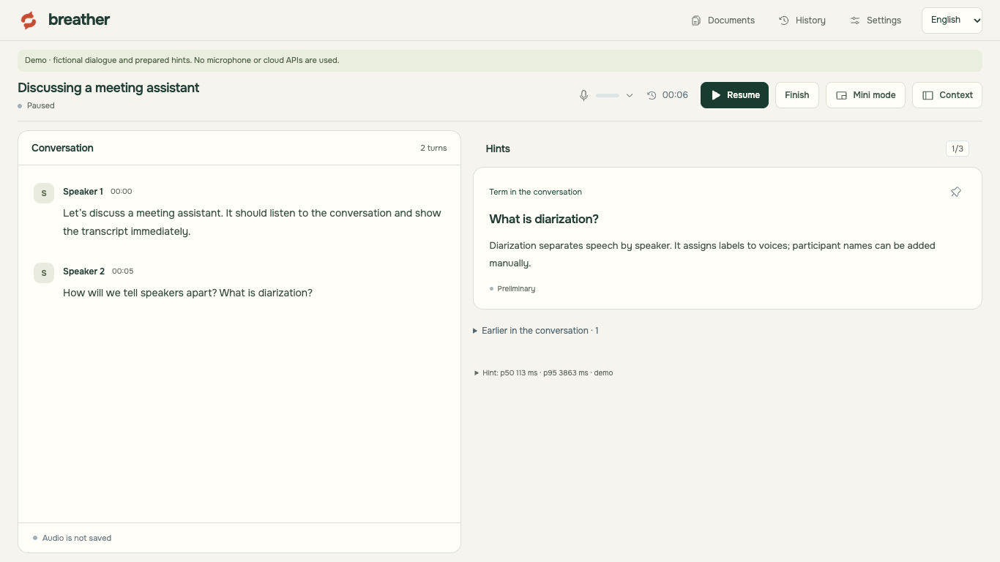
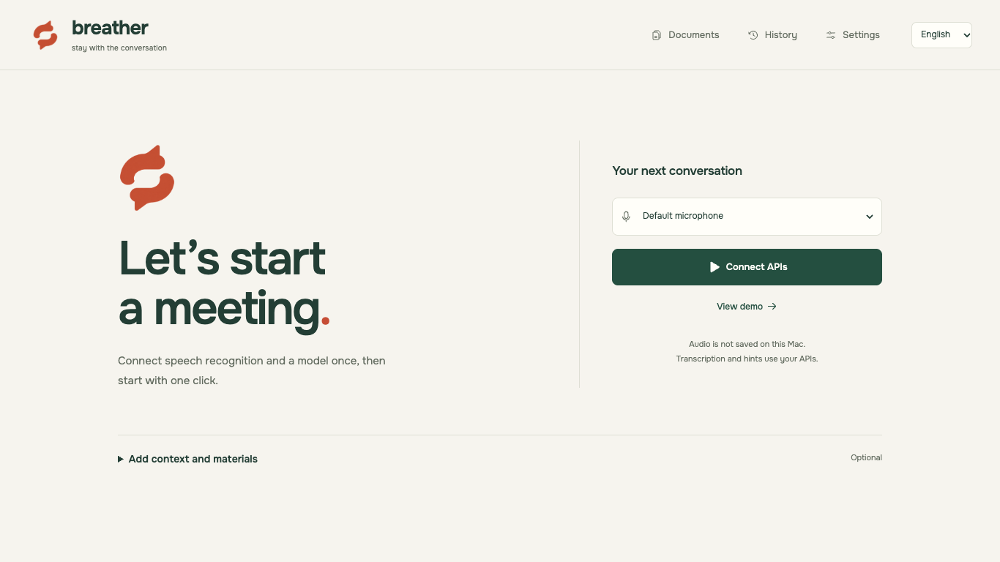
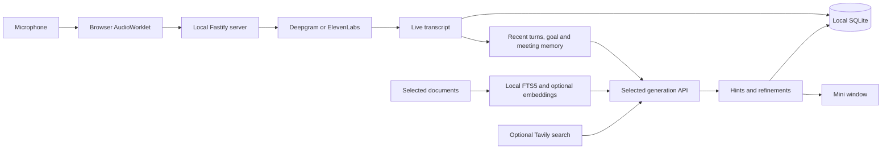
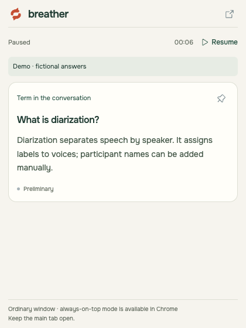
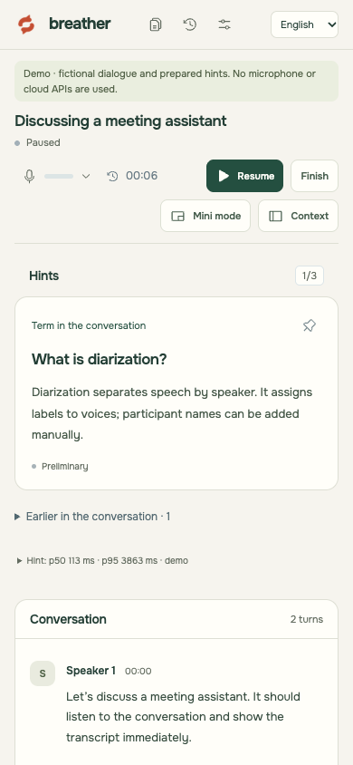

# Breather

**Stay with the conversation. Keep the next useful answer close.**

Breather is a local web app for in-person meetings on a Mac. It turns microphone audio into a live transcript, surfaces short contextual hints, and refines answers using selected documents and optional web sources. Meeting history, documents, and settings stay on your machine; speech recognition and AI processing use the APIs you choose.

The interface supports **English and Russian**, with English as the default. Use the language selector in the header to switch instantly; your preference is saved in this browser. The mini window follows the same preference.



*Actual application screenshot in demo mode: fictional dialogue and prepared hints, with no microphone or cloud requests.*

## What it does

- **Follow the conversation:** streaming transcription with corrections to partial text. Deepgram supports speaker labels; ElevenLabs uses a single conversation feed.
- **Get help in context:** short preliminary answers, explanations of terms, and possible questions, followed by source-backed refinements when available.
- **Bring your materials:** searchable PDF, TXT, and Markdown documents with links to the passages used in an answer.
- **Keep the meeting in focus:** an editable goal, a rolling summary, questions, topics, and decisions linked to transcript evidence.
- **Keep hints nearby:** a compact mini window with the same hints, pinning, and pause controls as the main workspace.
- **Review afterward:** local meeting history, latency measurements, token usage, and estimated spending based on your configured rates.

## Quick start

Install **Node.js 24 LTS**, npm, and Google Chrome, then run:

```sh
git clone https://github.com/dmitrymalakhov/breather.git
cd breather
npm start
```

Open [http://127.0.0.1:4317](http://127.0.0.1:4317) in Chrome. Stop the server with `Ctrl+C` in the terminal.

The startup script installs missing dependencies from `package-lock.json`, builds the client and server, and rebuilds `better-sqlite3` if its native module was installed under a different Node version. It can also find Node.js 24 in a local Codex runtime or an nvm installation. Set `SUFLER_NODE_BIN` to provide an explicit Node executable.

**Try it without API keys:** select **View demo**. The demo uses fictional dialogue and prepared hints, without accessing the microphone or cloud APIs.



*Start with a demo, or connect speech recognition and an AI provider for a live meeting.*

## Languages

English and Russian cover navigation, setup, settings, hints, history controls, usage labels, error messages, and the mini window. Dates, numbers, and plural forms follow the selected interface language. Demo dialogue and prepared hints are localized as well.

New meetings use the selected interface language for generated hints and summaries. Changing the interface during a meeting updates controls immediately; the meeting keeps the output language chosen at creation. Original transcript text, uploaded documents, custom participant names, and saved content keep their original language.

**Interface language and speech recognition language are separate.** Recognition defaults to automatic multilingual mode; the speech settings also offer an explicit Russian option. Switching the interface does not change your speech provider, reconnect the microphone, or submit API settings.

To add an interface language, extend `src/i18n.ts` and provide a complete catalog alongside `src/locales/en.json`. The Russian source strings serve as the fallback catalog.

## Your first live meeting

1. Select **Connect APIs**. Choose Deepgram or ElevenLabs and enter its speech API key and your generation API key. Defaults: OpenAI Responses, `https://api.openai.com/v1`, and `gpt-6-luna`. Expand the model/API section to change them. Select **Test and save** to return to the launcher. This checks generation connectivity; speech connectivity is checked when recognition starts.
2. Optionally add a text-layer PDF, TXT, or Markdown file under **Documents** and wait for indexing. Text files must be UTF-8. Uploads are limited to 20 MB; PDFs to 500 pages. Scanned PDFs require external OCR.
3. Optionally expand **Add context and materials** to set your goal, role, familiarity with the topic, and selected documents.
4. Choose a microphone and select **Start meeting**. Allow microphone access in Chrome. If macOS blocks it, enable Chrome under System Settings → Privacy & Security → Microphone.
5. With Deepgram, select a speaker name to rename it or mark **This is me**. Names are assigned manually. After speech reconnects, speakers receive new labels; check them again.
6. **Pause** turns off the microphone; **Resume** reconnects it. **Finish** saves the meeting to history and releases audio devices.

ElevenLabs uses Scribe v2 Realtime and shows a single **Conversation** feed, without speaker separation or a “This is me” marker. Create its key under Developers → API Keys with Speech to Text access. To change the speech provider or its key during a meeting, pause, save the settings, and resume.

Transcription continues during generation and retrieval. Partial text updates in place. Scroll upward to read older turns without automatic scrolling; **Jump to latest** restores following.

The hints panel shows up to three current or pinned hints. Earlier hints are available in an expandable archive. Expand sources to inspect the passages used; document links open the corresponding excerpt. **Possible question** is a model prediction. **Preliminary** means the answer has not been confirmed by sources.

## How it works



The browser captures mono PCM16 audio, resamples it to 24 kHz, and sends 100 ms packets to the local server. The server connects to your chosen speech service and normalizes its events. Generation uses recent conversation, the meeting goal, and accumulated meeting memory. Document retrieval and optional web search can refine the preliminary answer.

## Compact workspace and mini mode

The meeting header stays compact so the live feeds can use most of the window height. **Context** opens the goal, summary, and usage panel. On mobile layouts, hints appear before the transcript. Select the microphone icon to choose an audio device; device changes require pausing.



*Mini mode showing the same English demo hint. This screenshot uses the ordinary popup fallback.*

Desktop Chrome uses Document Picture-in-Picture for a window that stays above other applications. If the API is unavailable, Breather opens an ordinary popup, without an always-on-top guarantee. If PiP fails, a button offers the ordinary window. Allow popups if your browser blocks them. The embedded Codex browser may support only the ordinary window; use desktop Chrome for the floating mode.

The mini window is a React portal into a same-origin document. It shares the existing meeting, WebSocket, microphone, and generation flow. Pinning, sources, and pause controls operate on that meeting. You can minimize the main window, but its tab must stay open; closing it also closes the mini window.

<details>
<summary>Mobile workspace</summary>



</details>

## Models, documents, and search

**OpenAI Responses** and **OpenAI-compatible Chat Completions** have independent adapters. For a compatible provider, enter its `baseURL`, model ID, and key. URLs must use HTTPS; local models may use HTTP on `localhost` or `127.0.0.1`. The provider must return a valid stream for the selected protocol. Changing the address requires a new key so an existing key is not forwarded to another server.

You can save generation settings during a meeting. Breather first makes a small test request. If it succeeds, the old generation is canceled and the new model receives the current context while transcription continues. Invalid keys, limits, and connection errors leave the working settings intact.

Embeddings are configured separately and default to `text-embedding-3-small`. Without a separate key, the configured OpenAI key is used. Changing the hint model does not require reindexing. If you change the **embedding model or endpoint**, upload the materials again: vectors with a different identifier are not used. Without embeddings, SQLite FTS5 provides keyword search without Russian morphology.

Tavily is optional. External facts are searched through a separate public query generated before document passages are added. Documents themselves are not sent in the Tavily query. The model is instructed to skip web search if it cannot separate a public topic from private details. Search failures preserve the preliminary answer.

## Meeting memory and spending

The **Meeting focus** section, available through Context, stores questions, topics, and decisions with links to finalized transcript turns. Mark a question as answered; that manual status persists through later updates. You can edit the goal during the meeting to guide concrete next steps.

Earlier items remain when the topic changes. The rolling summary and open questions supplement the last two minutes of transcript used for hints. Summaries are model interpretations: evidence links confirm that a turn exists, not that the interpretation is correct. Paraphrased items may be duplicated.

SQLite records generation attempts, actual input/output/cached token counts from API usage, errors and cancellations, and audio seconds sent per speech connection. Compatible APIs must support `stream_options.include_usage`; without usage, tokens and cost are explicitly unknown. Providers may charge for canceled requests even when usage is unavailable.

Per-meeting statistics appear in history; overall totals appear in rate settings. Deleting a meeting removes its usage from the totals. Usage for older history is not reconstructed.

Speech cost is estimated from audio duration; generation cost from tokens. Estimates use your configured USD rates and do not query provider invoices, rounding, or plan discounts. Check [ElevenLabs pricing](https://elevenlabs.io/pricing/api) and [Deepgram pricing](https://deepgram.com/pricing) before setting rates. Fill in generation prices for the selected model ID and API; changing either resets those prices. Embeddings and Tavily costs are not tracked yet. `BILLING_RATES` and `SPEECH_OPTIONS` are stored as JSON in local settings.

Silence is not automatically removed from the audio stream, and the speech model is not automatically downgraded to save money. Pausing stops audio transmission. Shorter endpointing can finalize turns sooner but may split phrases; its quality tradeoff needs comparison on real conversations.

## Data and boundaries

- **Local server:** binds to `127.0.0.1` and validates Host and Origin. Mutating HTTP requests and WebSockets are accepted only from the app interface. One tab owns a meeting at a time.
- **Keys:** stored in `.env.local` with `0600` permissions. The public API exposes only whether keys are configured. Keys are excluded from client builds and logs. Environment variables take precedence over file settings; see [.env.example](.env.example).
- **Storage:** history, document text, vectors, hints, source excerpts, and measurements live in `data/sufler.sqlite` until removed through the interface. For backup or migration, stop the server and copy `data`; copy keys separately. The legacy `sufler.sqlite` filename and `SUFLER_NODE_BIN` environment variable are retained for compatibility with existing installations.
- **Audio and uploads:** raw audio stays in memory and is sent to the selected speech service. Audio files and original uploaded documents are not written to disk. Extracted document text is stored in SQLite.
- **Cloud processing:** Deepgram or ElevenLabs receives audio; the selected generation model receives meeting context and the passages used; the embedding API receives indexed document text. Storage is local; these processing steps use cloud APIs.
- **Interruptions:** old audio is not queued after a speech outage, and missing segments are marked in the transcript. Closing the tab pauses the stream. After a server restart, unfinished meetings open as completed; text remains saved and the microphone stays off.
- **Scope:** this version captures an in-person meeting microphone. System audio capture, online-call capture, OCR, and identifying real names from voices are outside its current scope.

The app assumes participants know their speech is sent to a recognition provider. Models can make mistakes; inspect sources when checking a claim.

## Architecture

| Path | Responsibility |
|---|---|
| `src/` | React UI, microphone control, transcript, hints, documents, and settings |
| `public/audio-worklet.js` | Mono PCM16, 24 kHz resampling, 100 ms packets, and audio level |
| `shared/types.ts` | Shared browser/server events and types |
| `server/speech.ts` | `SpeechProvider`, Deepgram Nova-3 / ElevenLabs Scribe v2 Realtime, turn normalization, and recovery |
| `server/session.ts` | Two-minute context, summary, trigger coalescing, cancellation, and versions |
| `server/ai.ts` | OpenAI Responses / Chat Completions streams, JSON decisions, embeddings, and errors |
| `server/documents.ts` | PDF.js worker, passages, FTS5/vector retrieval, and Tavily |
| `server/store.ts` | SQLite, migrations, local history, and metrics |
| `server/app.ts` | Fastify, HTTP/WebSocket, Origin/Host checks, and static UI serving |

ElevenLabs configuration: `model_id=scribe_v2_realtime`, `audio_format=pcm_24000`, `commit_strategy=vad`, and default `vad_silence_threshold_secs=0.5`. Available silence thresholds are 300/500/1000 ms; language options are automatic or Russian. Turn timestamps are estimated from sent audio; exact recognition latency is not measured for ElevenLabs.

Deepgram configuration: `model=nova-3`, `language=multi`, `interim_results=true`, `diarize_model=v1`, configurable `endpointing=500` by default, `encoding=linear16`, `sample_rate=24000`, and `channels=1`. The default hint model is `gpt-6-luna` with `reasoning.effort=none`. API adapters are independent of the UI; each new `SpeechProvider` must declare `supportsSpeakers`.

One primary analysis and one refinement may run concurrently. New context is coalesced instead of growing a queue. Refinements are canceled when the active version changes; responses from a previous model are not published after switching models.

Stable partial text is analyzed after 650 ms without changes, with at least four seconds between launches. Recognized questions and goal/model changes use a 1.5-second interval. The summary updates every minute from new finalized turns, in batches of at most 80 turns / 18,000 characters. Remaining turns are processed when the meeting finishes.

## Verification and latency

Run checks under **Node.js 24**:

```sh
npm run build
npm test
npm run test:e2e
```

To regenerate the English README screenshots from the actual demo UI:

```sh
BREATHER_CAPTURE_README=1 npm run test:e2e -- tests/browser/i18n.spec.ts
```

Playwright uses installed Google Chrome and two isolated local servers with test providers. Tests require no API keys or paid cloud requests.

The current version passed **33 Vitest tests and 12 Playwright scenarios**. Coverage includes both generation protocols, cancellation, speaker identifiers, partial-turn corrections, persistence and key permissions, PDF/Markdown/TXT handling and OCR errors, real AudioWorklet/getUserMedia with a synthetic Chrome microphone, pause/device release, documents/history, mobile widths, mini-window behavior, persistent language switching, and localized errors.

An accelerated one-hour simulation sends 36,000 audio packets and 1,200 turns while the model is busy. This is a simulation, not a one-hour field trial. See [VERIFICATION.md](VERIFICATION.md) for the detailed verification log in Russian.

Expand the measurements below the hints to inspect:

- **Hint p50/p95:** from the accepted analysis trigger to the first complete sentence, including launch delay.
- **Model p50/p95:** from request start to that sentence.
- **Recognition:** from the last audio packet associated with a turn to receiving it, estimated from browser capture timestamps in 100 ms packets.
- **End of turn to answer:** for `answer` events with a speech timestamp, including recognition and model wait time. Answers to earlier questions are associated with the latest finalized turn in the current context.

Demo measurements do not represent cloud performance. The target of **p50 ≤2 seconds / p95 ≤4 seconds** after sufficient recognized context is **not yet validated**. Neither is diarization quality in a real Russian-language meeting with 2–4 participants. Automated PiP tests validate the API and shared application state; physical always-on-top behavior over other macOS apps has not been field-tested.

For an initial field trial, start with 10–15 minutes of real conversation, then a one-hour meeting. Track questions, terms, interruptions, and topic changes; check speaker labels, sources, and p50/p95. Switch models during the meeting, try an invalid key, and briefly interrupt the network. After finishing, confirm that Chrome's microphone indicator is off and history survives a server restart.

## License

[Apache License 2.0](LICENSE).
